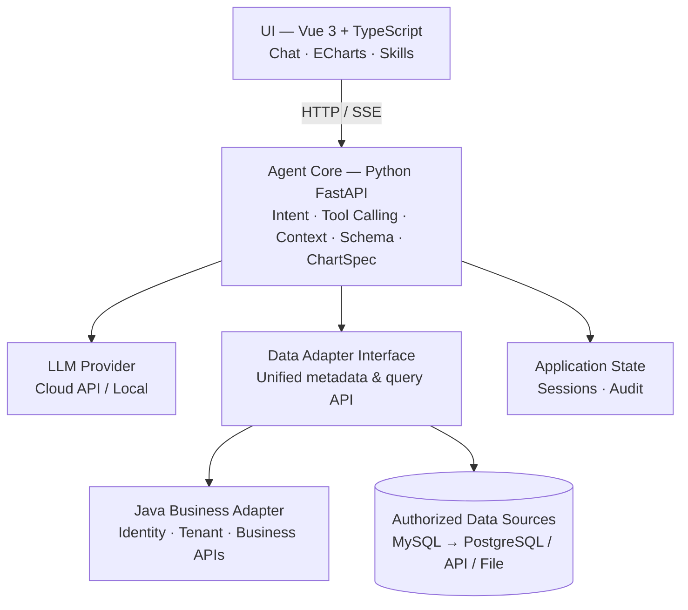

# AI Data Agent

> Ask your business data questions in plain language. Get charts, answers, and explanations — safely.
**AI Data Agent** is a private-deployable, conversational AI data-analysis assistant. It lets non-technical teams query, analyze, and visualize their own enterprise databases through natural language — without writing SQL, and without giving a model free rein over the database.

The core idea: **trusted data access + AI analysis orchestration + business semantics + visualization**. Not a rebuild of drag-and-drop BI, and not a model with unrestricted database access.

---

## ✨ Features

- 🔍 **Natural-language to insight** — ask questions like *"How did member spending trend over the last three months?"* and get a conclusion, a chart, and its data source.
- 📊 **Automatic visualization** — Apache ECharts charts are selected and generated from query results, annotated with metric definitions and caveats.
- 💬 **Multi-turn analysis** — follow up to change time ranges, swap dimensions or metrics, or switch chart types; the agent carries context forward.
- 🧩 **Skills** — reusable domain capabilities (membership RFM, repurchase analysis, format sales…) that package business rules, workflows, and permitted tools.
- 🔒 **Security by design** — read-only SQL, object whitelists, tenant isolation, resource limits, and full audit logging. The model never holds database credentials.
- 🏢 **Enterprise integration** — a Java Business Adapter reuses existing identity, tenant, and business APIs from legacy systems; no rewrite required.
- ☁️ **Model flexibility** — third-party LLM APIs by default, with an open interface for enterprise-chosen providers or local inference.

---

## 🏗️ Architecture



**Responsibility boundaries**

| Layer | Does | Never does |
|---|---|---|
| UI (Vue + ECharts) | Conversation, ChartSpec rendering | Executes SQL, stores credentials |
| Python Agent Core | Planning, orchestration, multi-turn context | Embeds legacy-system logic |
| Adapters | Isolate data sources behind one interface | — |
| LLM Provider | Swappable: cloud API → local inference | Holds database passwords |

---

## 🚀 Quickstart

> ⚠️ Early-stage project. Commands below reflect the target stack — check the repo for the latest setup.

```bash
# 1. Clone
git clone https://github.com/xk103295870-alt/new-AI-data.git
cd new-AI-data

# 2. Backend (Python / FastAPI)
cd backend
python -m venv .venv && source .venv/bin/activate
pip install -r requirements.txt
# Configure your authorized read-only data source & LLM provider in .env
uvicorn app.main:app --reload --port 8000

# 3. Frontend (Vue 3)
cd ../frontend
npm install
npm run dev

# 4. Open
# http://localhost:5173
```

**Requirements**: Python ≥ 3.10 · Node.js ≥ 18 · an authorized, read-only MySQL data source · an LLM API key (or a local inference endpoint).

---

## 🔐 Security Model

1. **Least privilege** — real business data stays within authorized scope; test copies or permission-scoped views preferred.
2. **No credentials in the model** — the model never holds database passwords and cannot bypass the executor; every query is validated server-side.
3. **Hard tenant isolation** — enforced by trusted identity plus database/view/gateway permissions, never a model-supplied `WHERE` clause.
4. **Constrained queries** — read-only SQL, object whitelists, scan/time/row limits, and audit logging; SQL AST checks are one layer of many.
5. **Schema minimization** — sensitive business knowledge is filtered before any third-party model call; masked or aggregated data only.
6. **Explainable results** — metric definitions, reasoning, sources, and limitations are always shown; the system never fabricates metrics, data, or table structures.

---

## 🗺️ Roadmap

| Phase | Focus | Scope |
|---|---|---|
| **1 · MVP / Demo** ✅ *current* | Core loop | Authorized MySQL → schema → NL analysis → safe SQL → charts + basic follow-ups |
| **2 · Agent & Skills** | Capability | Skill registration/execution, metric dictionary, export & favorites, Java integration |
| **3 · Private & OSS** | Productization | Identity & permissions, multi-source/tenant, audit, Docker deployment, open-sourcing |
| **4 · Desktop & Commercial** | Scale | Tauri/Electron packaging, installers, industry customization, paid capabilities |

---

## 🤝 Contributing

This project is in early development. Issues, discussions, and pull requests are welcome — especially around:

- New data adapters (PostgreSQL, Excel/CSV, REST APIs)
- Domain Skills (membership, commerce, property, retail formats)
- Query-safety hardening and evaluation benchmarks

Before contributing, please read [CONTRIBUTING.md](CONTRIBUTING.md) *(coming soon)*.

---

## 📄 License

License is **to be determined** before official release, pending a full review of all third-party dependencies. See [LICENSE](LICENSE) *(coming soon)*.

---

## 🏢 About

Built by **Weino Technology (微诺科技)**. The project grows out of real commerce, property, and membership systems — designed so that business teams can finally ask their own data questions, safely.

> North Star reminder: build the Phase 1 loop well — real schema, safe queries, honest answers.
